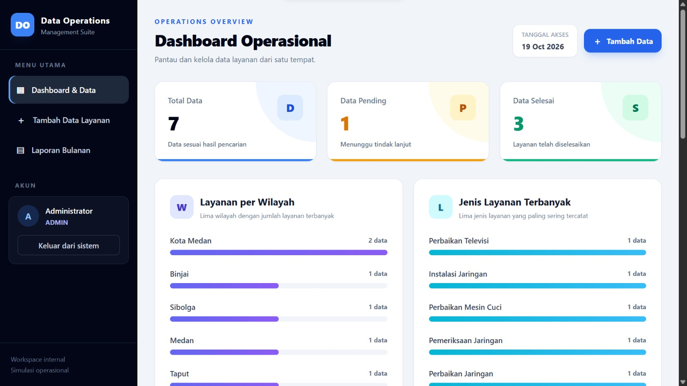
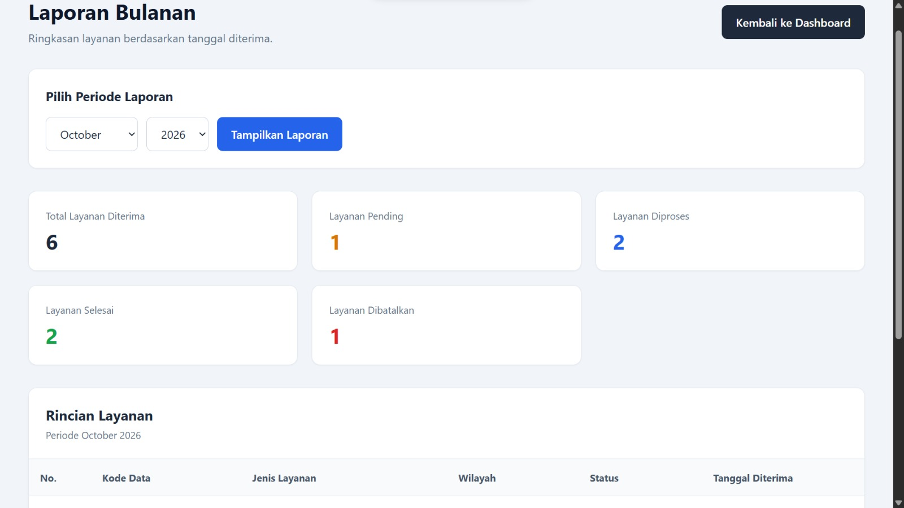

# Data Operations Suite

### Laporan Bulanan


Aplikasi web untuk mengelola data operasional secara terstruktur, dilengkapi autentikasi, pembagian hak akses, pencarian, filter, ekspor CSV, dan laporan bulanan.

Proyek ini dikembangkan sebagai portofolio untuk menunjukkan penerapan pengembangan aplikasi web dan pengelolaan data operasional menggunakan Laravel.

## Fitur Utama

- **Dashboard operasional** — ringkasan data dan status layanan.
- **Manajemen data** — menambah, melihat detail, dan mengedit catatan operasional.
- **Pencarian dan filter** — membantu menemukan data berdasarkan informasi yang tersedia.
- **Validasi formulir** — memvalidasi kolom wajib, status, dan kode data unik.
- **Hak akses berbasis peran** — membedakan izin Admin dan Operator.
- **Ekspor CSV** — mengunduh data untuk kebutuhan pengolahan lebih lanjut.
- **Laporan bulanan** — menampilkan laporan berdasarkan periode bulan dan tahun.
- **Autentikasi pengguna** — login, logout, dan pengelolaan profil.
- **Pengujian otomatis** — pengujian fitur menggunakan Laravel testing tools.

## Teknologi

- PHP 8.2
- Laravel 12
- Blade
- Tailwind CSS
- Vite
- Node.js dan npm
- Database sesuai konfigurasi lingkungan aplikasi

## Hak Akses

| Fitur | Admin | Operator |
|---|---|---|
| Melihat data | Ya | Ya |
| Menambah data | Ya | Ya |
| Melihat detail | Ya | Ya |
| Mengedit data | Ya | Ya |
| Menghapus data | Ya | Tidak |
| Ekspor CSV | Ya | Tidak |
| Laporan bulanan | Ya | Tidak |

## Struktur Data

Setiap catatan operasional dapat mencakup:

| Kolom | Keterangan |
|---|---|
| Kode data | Identitas unik catatan |
| Jenis layanan | Kategori layanan operasional |
| Wilayah | Wilayah layanan |
| Referensi pelanggan | Referensi pelanggan, jika tersedia |
| Status | Pending, Processing, Completed, atau Cancelled |
| Tanggal diterima | Tanggal penerimaan catatan |
| Catatan | Informasi tambahan |

## Instalasi Lokal

### Persyaratan

Pastikan PHP, Composer, Node.js, npm, dan database yang sesuai dengan konfigurasi proyek sudah tersedia.

### 1. Clone repositori

Ganti URL repositori dengan URL GitHub milik proyek ini.

```bash
git clone <URL_REPOSITORI>
cd data-operations-suite
```

### 2. Instal dependensi

```bash
composer install
npm install
```

### 3. Siapkan konfigurasi

Salin `.env.example` menjadi `.env`:

```cmd
copy .env.example .env
```

Buat application key:

```bash
php artisan key:generate
```

Sesuaikan konfigurasi database di `.env` dengan lingkungan lokal.

### 4. Siapkan database

Setelah memastikan konfigurasi dan kondisi database benar, jalankan migrasi yang diperlukan:

```bash
php artisan migrate
```

Jangan menjalankan migrasi pada database yang sudah berisi data penting tanpa pencadangan dan pemeriksaan terlebih dahulu.

### 5. Build frontend

```bash
npm run build
```

### 6. Jalankan aplikasi

```bash
php artisan serve
```

Buka `http://127.0.0.1:8000` di browser.

Buat atau siapkan akun Admin dan Operator melalui proses provisioning pengguna yang aman. Pendaftaran publik dinonaktifkan pada konfigurasi aplikasi saat ini.

## Pengujian

Jalankan:

```bash
php artisan test
```

Pada pengujian lokal tanggal 19 Oktober 2026, tercatat:

- 24 pengujian berhasil.
- 59 assertions.
- Build frontend Vite berhasil.

Hasil tersebut merupakan hasil pengujian di lingkungan pengembangan dan tidak menjamin seluruh kemungkinan masalah sudah tercakup.

## Keamanan

- Pendaftaran publik dinonaktifkan.
- Akses fitur dibatasi berdasarkan peran.
- Jangan mengunggah `.env`, kredensial, kata sandi, atau data pelanggan asli.
- Gunakan data sintetis untuk demonstrasi portofolio.
- Pastikan file database dan backup lokal tidak ikut dipublikasikan.

## Tujuan Proyek

Data Operations Suite dibuat untuk mendemonstrasikan pengelolaan data operasional, validasi, autentikasi, otorisasi, pelaporan, ekspor data, dan pengujian aplikasi web.

## Status

Fitur inti telah melalui pengujian manual dan pengujian otomatis awal. Pemeriksaan lanjutan tetap diperlukan sebelum aplikasi digunakan di lingkungan produksi.
